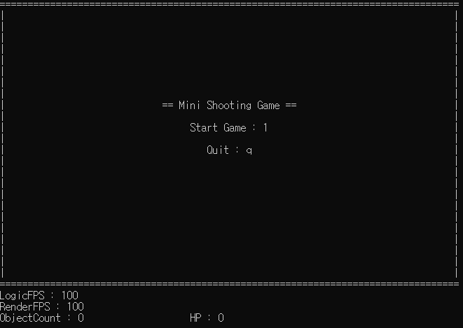

# 📌 [객체지향 콘솔 슈팅 게임 미니프로젝트]

객체지향으로 구현하는 콘솔 슈팅 게임 미니프로젝트입니다.  

 

# 🎯 제작 목적

- 전반적인 게임루프의 흐름을 객체지향 코드로 표현하는 연습을 위함.
- 객체지향이 무엇인지 직접 몸으로 느껴보기 위해. 최대한 각 객체들이 본인의 로직을 직접 수행하는 구조로 작업.
- 게임엔진, 프레임워크의 구조를 일부 학습하기 위함. 가상함수의 다형성을 활용하여 오브젝트나 씬을 추가할 때 BaseClass를 상속하여 Update(), Render()등을 오버라이딩하기만 하면 알아서 동작.

 

# 🛠️ 사용 기술

- C++
- 객체지향
- 가상함수의 다형성을 활용한 프레임워크적 사고
- 직접 만든 Iterator + List
- LogicFPS 보장, FPS 제한, 렌더링 스킵 기법

 

# ⚙️ 주요 기능

- 타이틀씬, 게임씬, 게임클리어씬, 게임오버씬 총 4개의 씬으로 구성.
- 플레이어는 움직이며 총을 발사하는 적군을 모두 죽여야 게임 클리어.
- 게임씬을 제외한 다른 씬에서 q를 눌러 게임의 정상적인 종료.

 

# 🏗️ 구조

### 게임 진행 흐름. 
TitleScene -> GameScene -> Game Clear/Over Scene -> ExitScene

### List
- 직접 만든 Iterator 기반 List

### Manager
- ConsoleManager -- 콘솔 커서 숨김 및 이동
- FPSManager -- FPS 제한 및 렌더링 스킵
- ObjectManager -- 오브젝트 관리, 충돌처리
- SceneManager -- 씬 처리
- ScreenManager -- 화면 출력
- TimeManager -- deltaTime 계산

### Object
- ObjectType -- 오브젝트 타입 enum class
- BaseObject -- 베이스 오브젝트
- Player
- PlayerBullet
- Enemy
- EnemyBullet

### Scene
- BaseScene -- 베이스 씬
- TitleScene
- GameScene
- Game Clear/Over Scene
- ExitScene

### Main
- SceneManager::Run()

 

# 📚 배운 점
- 객체지향 + 가상함수 다형성의 활용이 코드의 유지보수 + 확장성 측면에서 굉장히 뛰어나다는 것을 체감하였음.
- 프레임 제한에 고해상도 타이머를 도입하며 (ns, us, ms) <-> (TSC) 단위 변환에 조금 더 익숙해짐.

# 🔥 문제 해결

### [타이틀에서 게임 시작 시 모든 오브젝트가 소멸되는 문제]

LoadScene(new nextScene); 을 호출하여 다음 씬을 미리 생성해두고. 이번 프레임의 할 일을 모두 마치고 마지막에 현재 씬을 파괴하며 받아둔 다음씬으로 교체함.  
 
각 씬의 생성자에서 오브젝트 생성.  
각 씬의 소멸자에서 오브젝트 파괴.  
 
즉. 씬의 교체 방식이 지연 교체이다보니 이전씬의 소멸, 다음씬의 생성 순서가 서로 뒤바뀌면서 다음씬을 위해 만들어진 오브젝트들이 이전씬의 소멸과함께 전부 사라짐.  

### 해결방안

BaseScene에 OnInit(), OnDestroy() 가상함수를 만들어 씬마다 오버라이딩.  
각자의 씬에 맞게 초기화, 소멸 작업을 따로 함수로 마련.  
이후 만들어진 함수를 이용하여 씬마다의 초기화, 소멸 작업을 원하는 시점에 호출하도록 구조를 변경하여 작업의 순서를 정상적으로 보존하며 해결.  

### 배운 점

생성자, 소멸자를 활용하여 씬마다 초기화, 소멸 작업을 지정하는 것보다  
OnInit(), OnDestroy() 멤버함수를 따로 만들어 관리하는 방법이   
작업의 순서를 내가 원하는 시점으로 관리하기 용이하다는 점을 배움.  

 

### [FPS 제한이 정확하지 못한 문제]

기존에 FPS 제한에 1ms 해상도 타이머와 Sleep() 함수를 사용.  
Sleep() 함수는 1ms 단위의 인자를 받을 수 있는데, 60fps는 1프레임에 16.6666.... ms를 필요로 함.  
소수점 아래 단위를 정확하게 계산하기 어려운 문제 발생.  

### 해결방안

사용하는 타이머를 QueryPerformanceCounter()로 변경. 현재 QPC의 해상도는 100ns이며 기존보다 소수점 아래 4자리까지 더 수용 가능.  
Sleep() 함수대신 더 넓은 단위를 지원하는 std::this_thread::sleep_for() + std::chrono::nanoseconds() 사용  

### 배운 점

더 높은 해상도를 가지는 타이머와 Sleep 함수를 사용하여 정밀한 FPS 제한 방법을 배움.  

